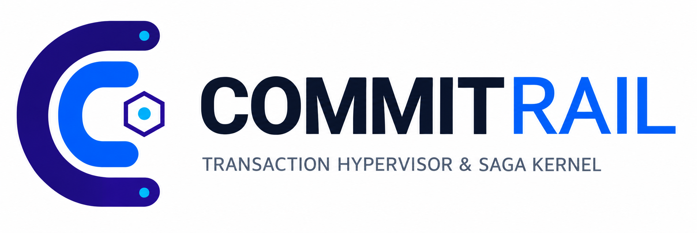

# CommitRail

<div align="center">
  
</div>

CommitRail is a transactional execution and recovery infrastructure layer designed to make autonomous AI agents safer and more reliable when interacting with real-world systems.

It sits between an AI agent and the tools, APIs, databases, payment platforms, and cloud services that can cause irreversible damage when invoked carelessly.

## What CommitRail does

- Prevents duplicate operations
- Wraps risky actions in transactional execution
- Audits every decision and side effect
- Recovers from partial failures safely
- Enforces approvals, limits, and business rules
- Coordinates multi-agent workflows without destructive races

## Use Cases

- Preventing Duplicate Payments
- Safely Executing AI-Powered Purchases
- Protecting Cloud Infrastructure From AI Mistakes
- Recovering Failed AI Workflows After Crashes
- Safely Updating Databases and Customer Records
- Managing Orders, Payments, and Deliveries
- Preventing Unauthorized AI Actions
- Enforcing Spending Limits Across AI Agents
- Safely Retrying Failed API Requests
- Managing Refunds and Cancellations
- Automating Employee Onboarding and Offboarding
- Coordinating Multiple AI Agents
- Recovering From Partially Completed Transactions
- Tracking and Auditing AI Actions
- Safely Automating Financial Operations
- Managing AI-Powered Procurement
- Preventing Conflicting Operations Between Agents
- Recovering Failed Cloud Deployments
- Safely Automating Business Workflows
- Reconciling Uncertain Payment Outcomes
- Controlling AI Agents With Access to Critical Systems
- Managing Long-Running Autonomous Tasks
- Coordinating Actions Across Multiple External Services
- Enforcing Business Rules Before AI Actions Execute
- Maintaining Reliable Execution Records for AI Agents

## Architecture Map

CommitRail sits between the AI agent and external systems, intercepting actions before they execute and enforcing guardrails, approval checks, transactional boundaries, and recovery logic.

```
┌───────────────────────────────────────────────────────────────────────┐
│                         AI Agent                                │
│                    (Autonomous Action)                          │
└────────────────────────┬───────────────────────────────────────┘
                          │
                          ▼
┌───────────────────────────────────────────────────────────────────────┐
│                    CommitRail Guardrails                        │
│  ┌──────────────┐  ┌──────────────┐  ┌──────────────────────┐  │
│  │ Policy       │  │ Transactional│  │ Recovery & Audit     │  │
│  │ Checks       │  │ Execution    │  │ Trail                │  │
│  │              │  │              │  │                      │  │
│  │ • Approvals  │  │ • Idempotency│  │ • Rollback Safety    │  │
│  │ • Rate Limits│  │ • State Mgmt │  │ • Transaction Logs   │  │
│  │ • Business   │  │ • Atomicity  │  │ • Audit Records      │  │
│  │   Rules      │  │              │  │ • Error Recovery     │  │
│  └──────────────┘  └──────────────┘  └──────────────────────┘  │
└────────────────────────┬───────────────────────────────────────┘
                          │
         ┌────────────────┼────────────────┐
         ▼                ▼                ▼
    ┌─────────┐      ┌─────────┐      ┌──────────┐
    │ Stripe  │      │   AWS   │      │ Database │
    │         │      │         │      │          │
    │(Payment │      │(Storage,│      │(Customer │
    │ Gateway)│      │Compute) │      │ Records) │
    └─────────┘      └─────────┘      └──────────┘
```
<div align="center">
  
</div>


This design ensures the agent never directly performs high-risk actions without validation, state tracking, and a safe rollback path.

## Product direction

This repository is being expanded into a dark-themed SaaS product experience for AI agent safety and execution governance.

The product emphasizes:
- Security and trust
- Recovery and guardrails
- Transactional reliability
- Compliance and auditability
- Multi-agent coordination
